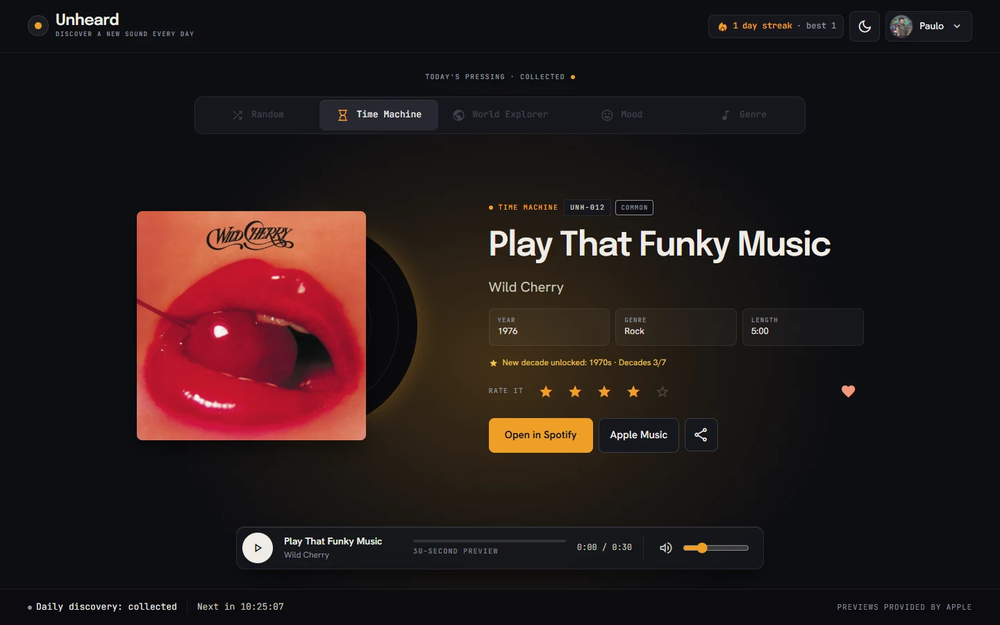
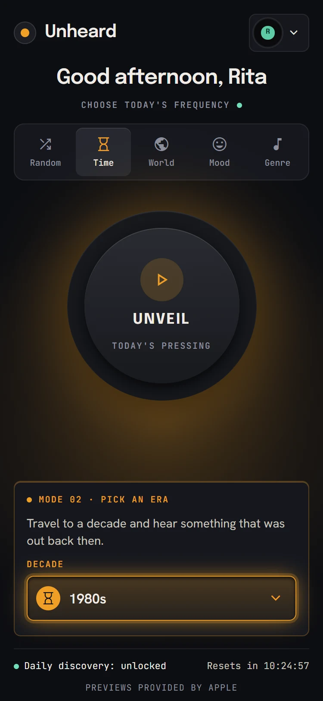
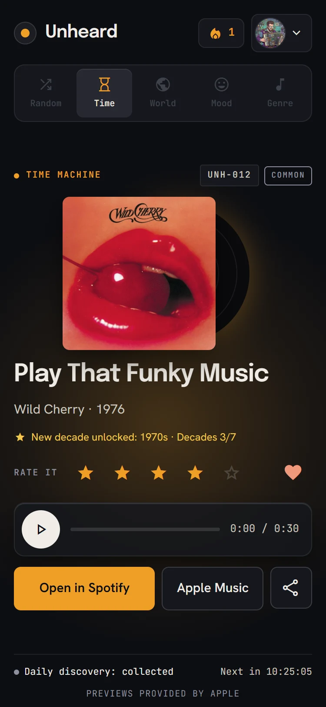
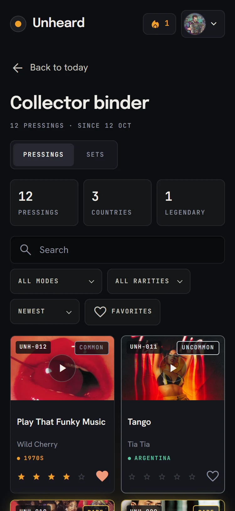
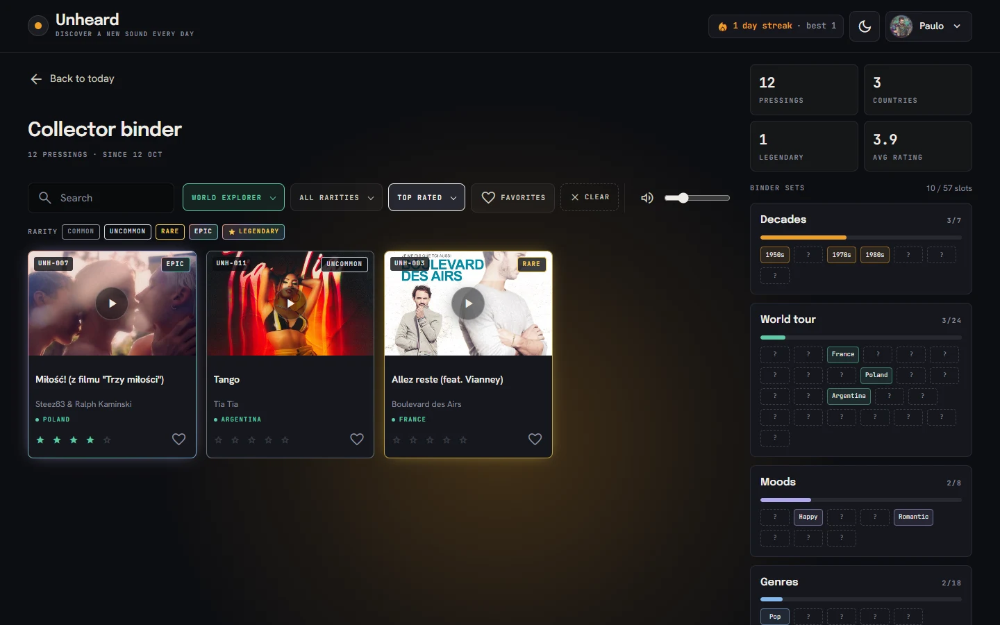
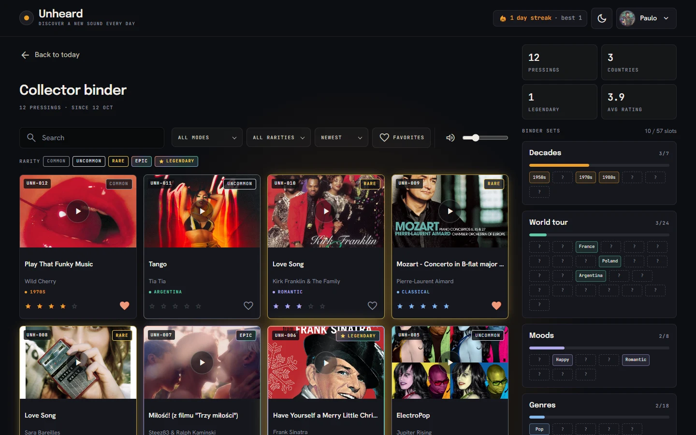
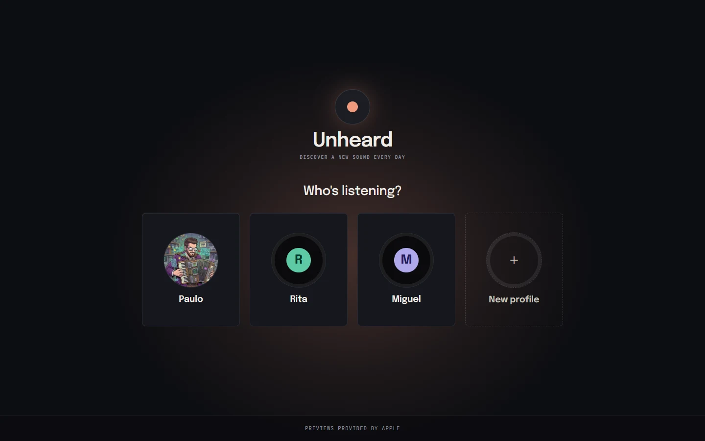
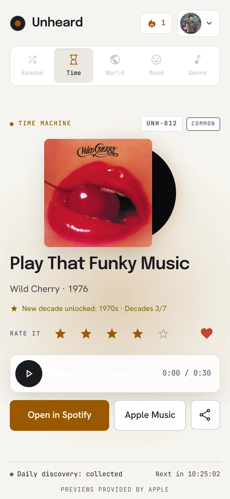
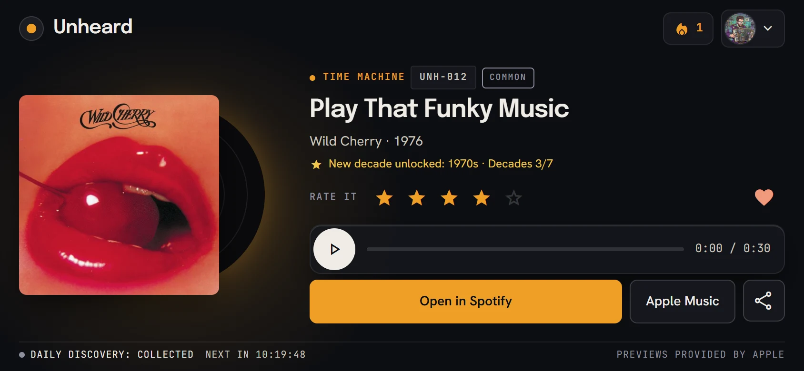
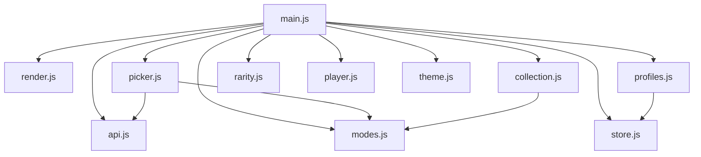

# Unheard

**One song you've never heard, every day.**

[Open the app](https://PauloDuarteOliveira.github.io/unheard/) · [How it works](#how-it-works) · [Features](#features) · [How it's built](#how-its-built) · [Run it locally](#run-it-locally)

 

<picture>
  <source media="(prefers-color-scheme: light)" srcset="docs/screenshots/revealed-desktop-light.webp">
  
</picture>

Unheard is a small daily ritual for finding music outside your usual loop. You pick a way to discover (a random word, a decade, a country, a mood or a genre), and the app finds **one** song you can listen to, with a 30-second preview. Tomorrow brings a new one, and every song is saved as a card in your collector binder.

## How it works

<table>
  <tr>
    <td align="center" width="33%">
       
      <b>1. Pick a mode</b> 
      Random, a decade, a country, a mood or a genre.
    </td>
    <td align="center" width="33%">
       
      <b>2. Press play</b> 
      One song a day, with a 30-second preview.
    </td>
    <td align="center" width="33%">
       
      <b>3. Collect it</b> 
      Every song goes into your binder, with rarities to find.
    </td>
  </tr>
</table>

Behind the Unveil button, the app builds a search for the chosen mode, asks the iTunes Search API for songs, keeps the ones that fit, and checks that the preview really plays before accepting one. The day is then locked until local midnight, and a refresh shows the same song. A failed attempt never uses up the day.

## Features

<table>
  <tr>
    <td width="50%" valign="top">
       
      <b>Collector binder</b> 
      Search, filters that light up in their own color, a top rated sort, star ratings, favorites and a preview player that plays one card at a time.
    </td>
    <td width="50%" valign="top">
       
      <b>Rarity and sets</b> 
      Five tiers from Common to Legendary, with silver, gold and holographic frames, and sets to complete by decade, country, mood and genre.
    </td>
  </tr>
  <tr>
    <td width="50%" valign="top">
       
      <b>Profiles and avatars</b> 
      Several people per browser, each with a record color or an avatar, their own daily song, a streak, and Negative harmony to block genres they never want.
    </td>
    <td width="50%" valign="top">
      
       
      <b>Dark and light</b> 
      Dark by default, a light theme per profile, and every mode with its own color.
    </td>
  </tr>
</table>

Also: a first-visit intro that explains the app before asking for a name, the phone's Back button working inside the app, music that pauses when the app goes to the background, sharing today's song, exporting favorites as a playlist list, and a daily streak.

## Three layouts

  
  &nbsp;
  
  &nbsp;
  

The CSS is written mobile first, with one layout for phones, one for phones held sideways and one for desktop.

## How it's built

Plain HTML, CSS and JavaScript modules, with no frameworks and no build step. Songs come from the [iTunes Search API](https://developer.apple.com/library/archive/documentation/AudioVideo/Conceptual/iTuneSearchAPI/), and everything is saved in the browser.

Small helpers (dates, links, formatting) live in `utils.js`, which most modules import.

- **Closures:** `createStore`, `createPicker` and `createPreviewPlayer` are factory functions that keep private state.
- **Pure functions:** filtering, sorting, stats, sets and streaks in `collection.js` take data and return new data, without touching the page.
- **Events:** event delegation for the cards, stars and genre chips, `popstate` for the Back button and `visibilitychange` to pause the music.
- **Async:** `fetch` with `async`/`await` and `try`/`catch`, and the preview check wrapped in a `Promise` with a timeout.
- **Storage:** `localStorage` per profile, and `sessionStorage` for the binder filters and dev mode.

## Technical details

<b>Discovery modes</b>

| Mode | Dial | How the song is found |
|---|---|---|
| Random | none | a random word from 351 search terms |
| Time Machine | 7 decades, 1950s to 2010s | search terms typical of the decade, then only songs released in it |
| World Explorer | 24 countries | that country's iTunes store, with local search terms |
| Mood | 8 moods | search terms for each mood |
| Genre | 18 genres | genre search terms, then only songs of that genre |

Every dial starts on **Surprise me**, which picks a random option. While searching, the dial shows "Locked in" and the status line names the choice, for example "Going back to the 1980s" or "Traveling to Japan".

All the options and their search terms are in `data/pool.json`. Every decade and genre term was tested against the API, and terms that found too few matching songs were replaced.

- **If something fails**, an error card explains what happened (no connection, no playable song, or the search terms could not load) and offers **Try again**.
- **If a preview stops working after the day is locked**, the player shows **Re-roll**, which finds a new song in the same mode and keeps the same catalog number.
- **Share** copies "Today I discovered … by … 🎧" to the clipboard.

<b>Profiles, avatars and Negative harmony</b>

- **First visit:** with no profiles yet, the first screen explains the app in three steps (pick a mode, press play, collect it) and offers **Create your profile**. Once a profile exists, it becomes **Who's listening?** with a tile per profile.
- **Create your profile** asks for a name (up to 20 characters, no duplicates) and a look, with a live preview. The picker has two tabs: **Records** (six colors, the vinyl shows your initial) and **Avatars** (11 round pictures). Both are saved the same way, as one key, and an avatar may be used by several profiles.
- **Negative harmony** is an optional second step: block up to 3 genres you never want to hear. Blocked genres are removed from every mode's results and from the Genre dial. The app looks up each genre's `matches` in `data/pool.json` (the genre names iTunes uses, for example Hip-Hop is `"Hip-Hop/Rap"`) and drops every song whose `primaryGenreName` is on that list.
- **The profile menu** opens the **Collection** and **Settings**, and has **Log out**.
- **The streak** (🔥) counts the days in a row with a discovery. It is calculated from the collection dates, so it never goes out of sync.

Each profile has its own daily lock and catalog numbers. The app remembers the last profile and opens straight on its Today screen.

<b>Collector binder</b>

- **Cards** show the cover, catalog number, rarity badge, title, artist and a tag in the mode's color with what was chosen. When the dial was on "Surprise me", the tag shows the option the app actually picked.
- **Previews:** the binder has a single audio player (`js/player.js`), so starting another card stops the previous one. It also pauses today's song, and stops when you leave the binder.
- **Rate and favorite:** ratings and favorites made in the binder and on the Revealed screen always stay in sync, because both screens update every control for that catalog number.
- **Search** by title, artist or tag, **filter** by mode, rarity or favorites, and **sort** by newest, oldest, A–Z or top rated (unrated songs last). The filters are kept in `sessionStorage` (`unheard:binderFilters`), so they survive a refresh and reset on log out.
- **Active filters light up:** the mode filter takes the mode's color, the rarity filter the tier's color, and the sort turns white. A dashed **Clear** chip resets everything.
- **Sets:** World tour (24 countries), Decades (7), Moods (8) and Genres (18, minus blocked genres), each with a progress bar.
- **Volume (desktop):** one mute button and slider, shared with the Today player.

<b>Rarity rules and tuning</b>

Every discovery gets a rarity tier the moment it is found. It is saved with the card and never recalculated, because some factors (like "first song from this country") are only true on that day.

| Factor | Points |
|---|---|
| Released before 1970 / 1970–1989 / 1990–2009 | +3 / +2 / +1 |
| First World Explorer song from this country in the collection | +2 |
| First song from this genre in the collection | +2 |
| Shorter than 2:00 or longer than 7:00 | +1 |
| Luck | +0 to +3 |

| Points | Tier | Look |
|---|---|---|
| 0–2 | Common | plain frame |
| 3–4 | Uncommon | silver frame |
| 5 | Rare | gold frame and glow |
| 6 | Epic | thin holographic rim |
| 7+ | Legendary | thick holographic rim, gold glow, a shine across the cover and a star |

All the rules and thresholds are in `data/config.json`. They were tuned by scoring 89 real iTunes songs: iTunes mostly returns recent music, so the highest score was 7. That gives roughly 42% Common, 30% Uncommon, 18% Rare, 9% Epic and 1% Legendary. The scoring function takes the luck as an optional parameter, so it can be tested with fixed numbers.

<b>Settings and the light theme</b>

There is no Save button: every change is saved as soon as it is made.

- **Profile:** change the name and the look, with the same Records / Avatars tabs as on creation.
- **Negative harmony:** the same genre chips and 3-genre limit.
- **Preferences:** the **theme**, the default mode after logging in, and **Play preview on unveil** (off by default, because browsers may block sound that starts by itself).
- **Your data:** **Export favorites** downloads a text file with one `Artist - Title` per line, built in the browser with a `Blob`.
- **Delete profile** opens a confirmation `<dialog>` and removes only that profile's keys, never `localStorage.clear()`, because every GitHub Pages project of the same account shares one `localStorage`.

Every color in `css/style.css` is a CSS variable in `:root`, so the light theme is a second set of values in `:root[data-theme="light"]`, switched on by one attribute on `<html>`. The mode colors get deeper versions for the light page, to keep a contrast of at least 4.5:1 for text.

New settings are read with defaults (`{ ...DEFAULT_SETTINGS, ...saved }`), so profiles saved before a setting existed keep working.

<b>The Back button and focus</b>

Every screen has its own "Back to today" button, and the phone or browser Back button works too. One `showView` function draws each screen and keeps the history in step with the History API:

- Collection, Settings, Create profile, Negative harmony and the open profile menu add one history entry with `history.pushState`, without changing the URL.
- A `popstate` listener decides where Back goes: Today, Who's listening, the previous creation step, or just closing the menu.
- There is never more than one extra entry, so a second Back leaves the app as usual.
- `showView` also moves keyboard focus to the new screen's title, so keyboard and screen reader users don't lose their place.

<b>Data saved in the browser</b>

| `localStorage` key | What it holds |
|---|---|
| `unheard:profiles` | The list of profiles: id, name and avatar key (a record color or a picture) |
| `unheard:currentProfile` | The id of the logged-in profile |
| `unheard:<id>:today` | That profile's discovery of the day: date, mode, option, song and catalog number |
| `unheard:<id>:collection` | Every discovery of that profile, with its rating, favorite flag, rarity and whether it filled a new set slot |
| `unheard:<id>:settings` | Blocked genres, default mode, preview autoplay, theme and preview volume |

<b>Screen sizes</b>

| Layout | When | Media query |
|---|---|---|
| Phone portrait | the base rules | none |
| Desktop | wide and tall screens | `(min-width: 768px) and (min-height: 501px)` |
| Phone landscape | wide and short screens | `(orientation: landscape) and (max-height: 500px)` |

Desktop and landscape both build on the phone rules, so they never undo each other. On desktop and in landscape the screens use two columns, arranged with CSS grid. `renderPhase` writes the current phase on `<main>` as `data-phase`, and `renderView` writes the current screen on `<body>` as `data-screen`, so the CSS can change the layout per phase and per screen.

<b>Project structure</b>

| File | What it does |
|---|---|
| `index.html` | The single page of the app |
| `css/style.css` | Styles. Every color is a CSS variable, and each mode swaps its own color |
| `data/pool.json` | Search terms for every mode, and the iTunes genre names each genre matches |
| `data/config.json` | The avatars (six record colors and 11 pictures, told apart by an `image` field), and the rarity rules and tiers |
| `assets/avatars/` | The avatar pictures: 256×256 WebP |
| `docs/screenshots/` | The pictures in this README |
| `js/main.js` | Entry point: connects all the modules and handles clicks |
| `js/collection.js` | Pure functions for the binder: add, favorite, tag, stats, filter, sort, sets, favorites export and streaks |
| `js/rarity.js` | Scores a discovery and finds its rarity tier |
| `js/profiles.js` | Profile list, logged-in profile, name validation, and creating, editing and deleting profiles |
| `js/api.js` | iTunes Search API requests and the preview check |
| `js/modes.js` | The list of discovery modes and one query-building function per mode |
| `js/picker.js` | Picks a candidate without repeats, removes blocked genres and runs the discovery loop |
| `js/store.js` | Safe JSON reading and writing (in `localStorage` or `sessionStorage`), and one store per profile |
| `js/render.js` | Everything that changes the page, including the audio player |
| `js/theme.js` | Applies the selected mode's color and the dark or light theme |
| `js/player.js` | The binder's single preview player, as a closure: play, pause, stop, progress and volume |
| `js/utils.js` | Dates, countdown, greeting, links and other small helpers |

## Run it locally

This project uses JavaScript modules (`<script type="module">`), so it will not work by double-clicking `index.html`.

1. Clone the repository.
2. Open the folder in VS Code.
3. Right-click `index.html` and choose **Open with Live Server**.

To test more than one discovery a day, add `?dev=1` to the address. A small developer button appears in the footer that removes today's lock of the logged-in profile, so unveiling several times in a row fills the binder for a demo. Dev mode is kept in `sessionStorage`, so it disappears when the tab is closed.

## How Unheard differs from similar apps

| | unheardmusic.app | unheard.fm | This project |
|---|---|---|---|
| Starting point | A song you already like | Your own rules and filters | A discovery mode |
| How much | Up to 5 suggestions | Whole playlists | One song per day |
| Core idea | Similarity | Control, no repeats | A daily habit, and collecting |

The others start from what you already know. Unheard starts from somewhere you would not have looked, gives you only one song, and turns each day's discovery into a card in your collection.

## Credits

Made by Paulo Oliveira for the UPskill JavaScript course, 2026. Song data, covers and previews provided by Apple through the iTunes Search API. Icons are Google Material Symbols.
